<div align="center">

# ☀️ ÖkoInvest – Website & Plattform

**Aus Flächen werden Kraftwerke.**

Website und Plattform der **ÖkoInvest GmbH** (ÖKOVOLT Gruppe): Projektentwicklung für Freiflächen-PV, Agri-PV, Solarcarports und Großspeicher im DACH-Raum – mit Projektbörse, Portal für alle Beteiligten, über 20 Fachrechnern, Live-Strommarktdaten und einem belegten Faktenregister.


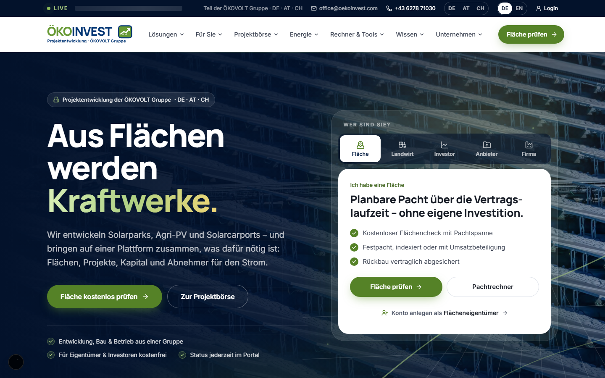

</div>

---

## Inhalt

1. [Was ist das hier?](#was-ist-das-hier)
2. [Bilder](#bilder)
3. [Das Ländermodell](#das-ländermodell)
4. [Funktionen der Website](#funktionen-der-website)
5. [Die Plattform (Portal)](#die-plattform-portal)
6. [Architektur](#architektur)
7. [Installation](#installation)
8. [Konfiguration](#konfiguration)
9. [Tests und Qualitätssicherung](#tests-und-qualitätssicherung)
10. [Projektstruktur](#projektstruktur)
11. [Grundsätze](#grundsätze)
12. [Dokumentation](#dokumentation)
13. [Vor dem Livegang](#vor-dem-livegang)
14. [Lizenz](#lizenz)

---

## Was ist das hier?

Zwei Produkte in einem Repository, aus einem Design-System:

| Produkt | Beschreibung |
|---|---|
| **Website** | Öffentlicher Auftritt mit Leistungsseiten, 20+ Fachrechnern, Projektbörse, Live-Strommarkt, Marktdaten-Zentrum, 38 Ratgeber-Artikeln, Lexikon und Regionalseiten – in vier Sprach-/Länderfassungen |
| **Plattform** | Geschütztes Portal (`/portal`) für Flächeneigentümer, Landwirte, Investoren, Anbieter, Unternehmen, Energiegemeinschafts-Mitglieder, Kommunen, Banken, Gutachter, Lieferanten und das Backoffice – mit CRM, KYC, Dealroom, Closing, EG-Abrechnung, Buchhaltung und Energie-Modulen |

Das Backend läuft wahlweise als **Demo** (lokale JSON-Datenbank, null Konfiguration) oder gegen **Frappe/ERPNext** (`Backend-Import/oekoinvest_app`).

---

## Bilder

### Website

| | |
|:---:|:---:|
| <br>**Startseite** – animierter Einstieg mit Rollenwahl | 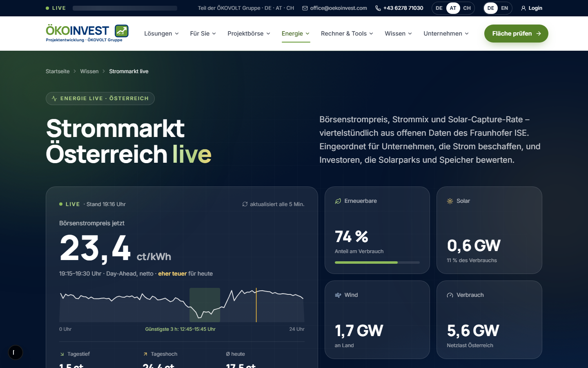<br>**Strommarkt live** – folgt der Länderwahl (hier: Österreich) |
| 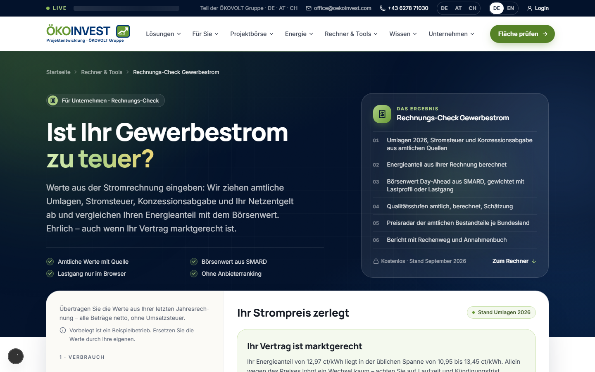<br>**Rechnungs-Check Gewerbestrom** – zerlegt die Stromrechnung in amtliche Bestandteile | 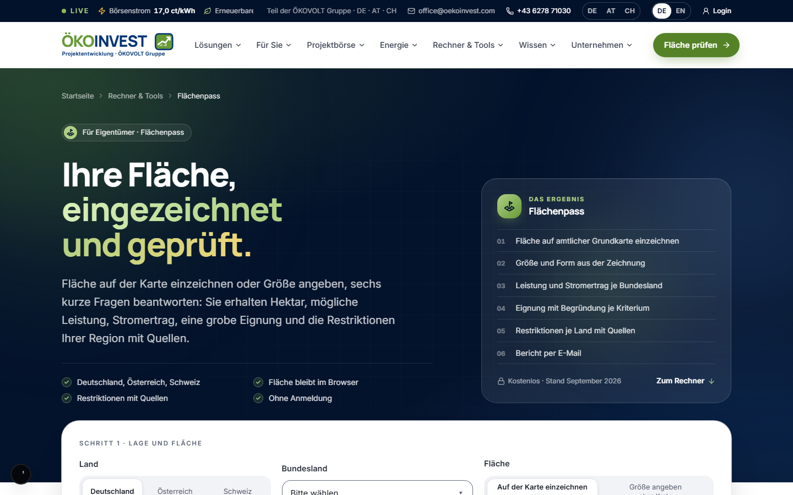<br>**Flächenpass** – Fläche einzeichnen, Eignung und Auflagen je Land |
| 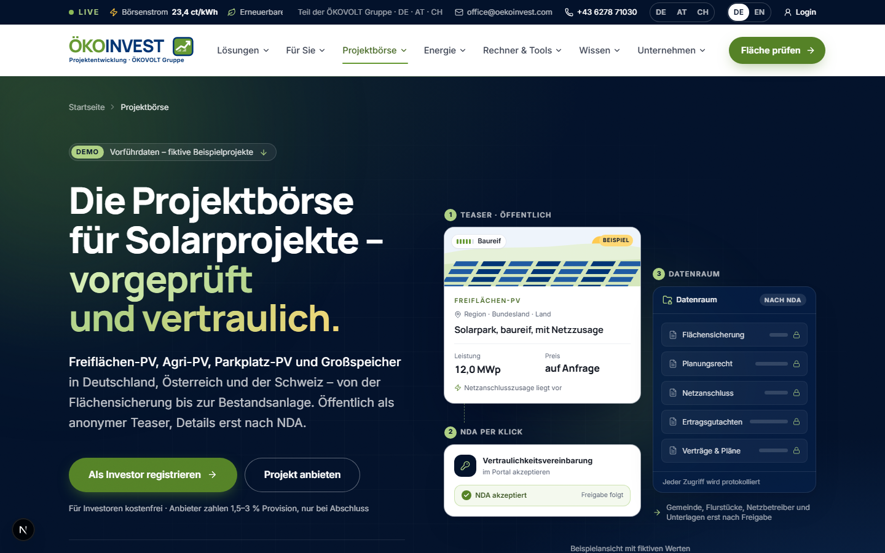<br>**Projektbörse** – neutraler Marktplatz mit NDA-Ablauf | 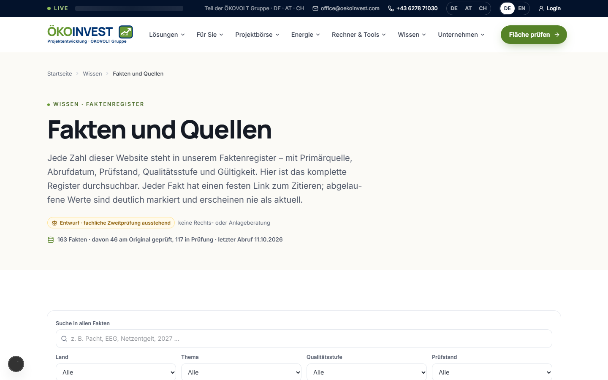<br>**Fakten & Quellen** – 163 belegte Fakten, durchsuchbar und zitierfähig |
| 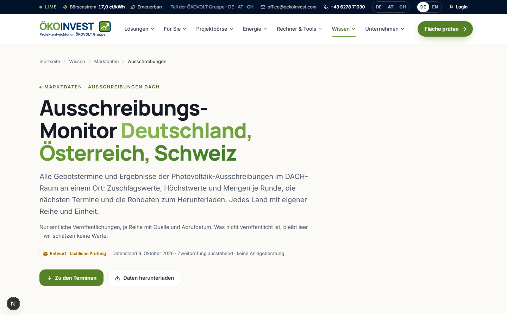<br>**Ausschreibungs-Monitor** – PV-Ausschreibungen DE/AT/CH mit Downloads | 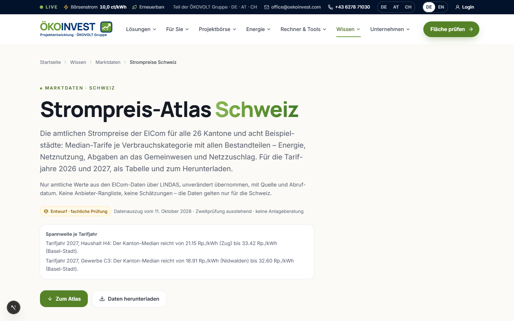<br>**CH-Strompreis-Atlas** – amtliche ElCom-Daten (Lizenz am Original geprüft) |
| 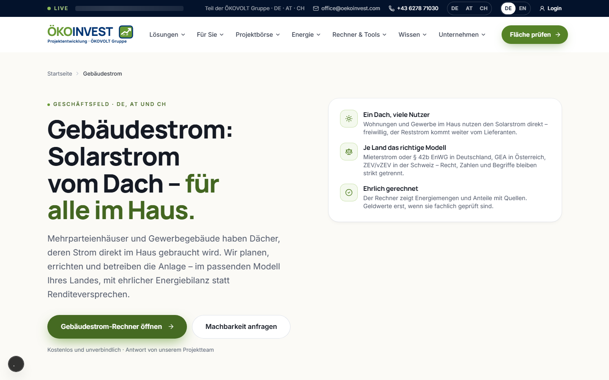<br>**Gebäudestrom** – Mieterstrom, § 42b EnWG, GEA, ZEV je Land | 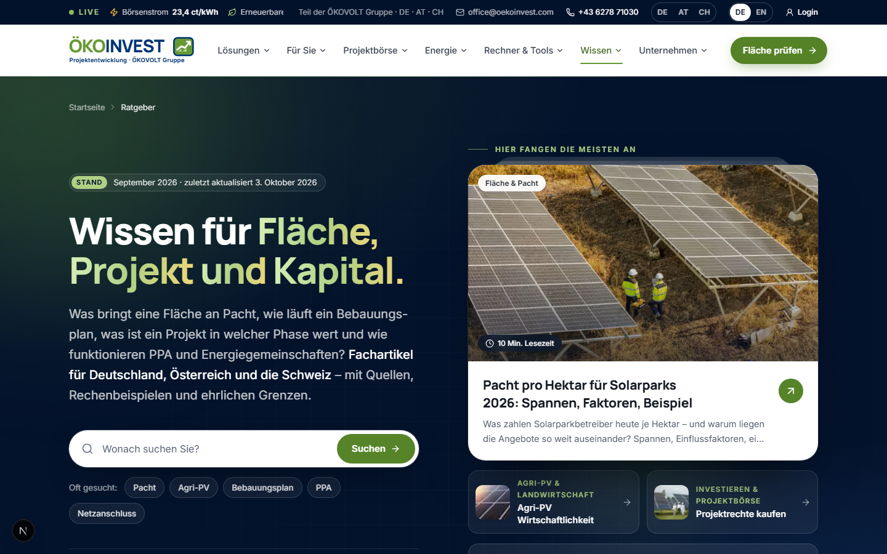<br>**Ratgeber** – 38 Fachartikel mit Fakten-Ankern |

### Plattform (Portal)

| | |
|:---:|:---:|
| 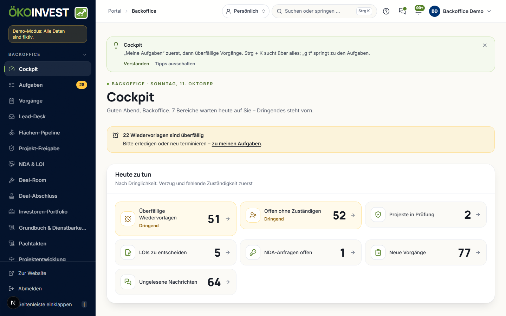<br>**Backoffice-Cockpit** – Aufgaben, Leads, Vorgänge | 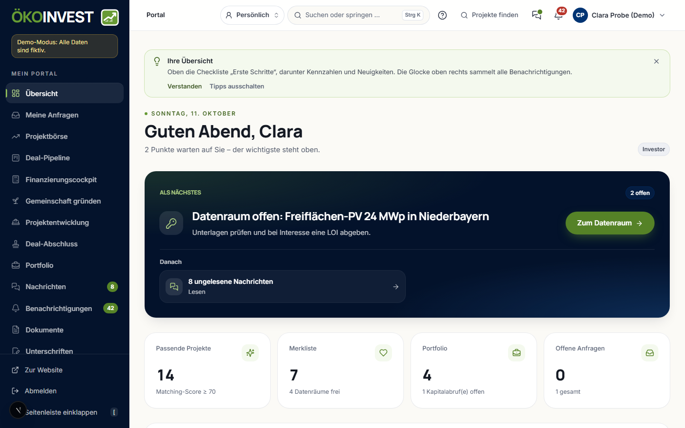<br>**Investor** – Portfolio, Dealroom, Datenraum |
| 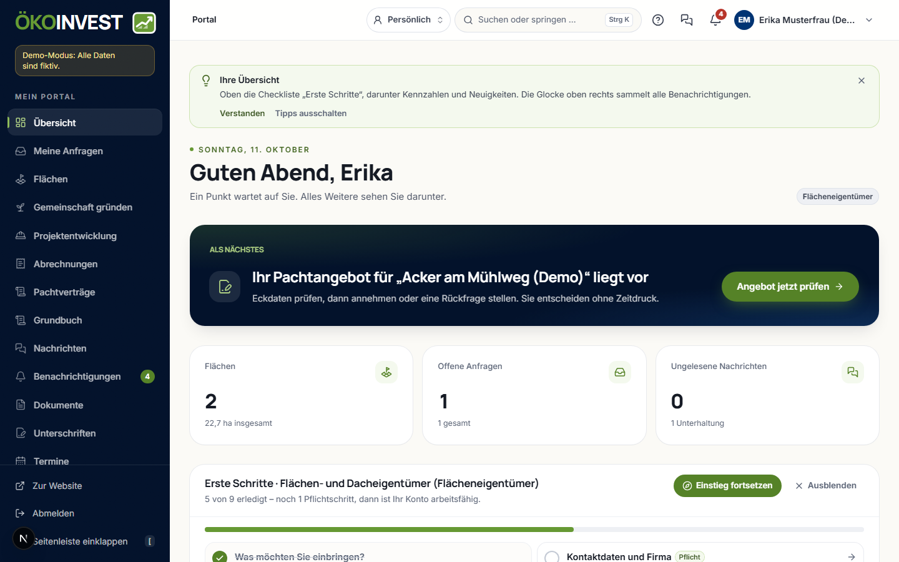<br>**Flächeneigentümer** – Flächen, Verträge, Status | 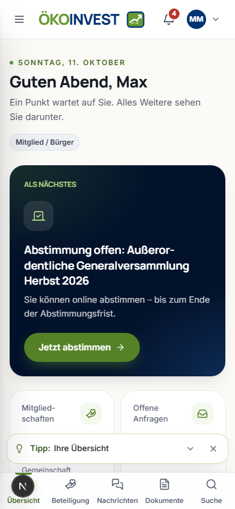<br>**EG-Mitglied, mobil** – Abstimmungen und Abrechnung |

### Mobil

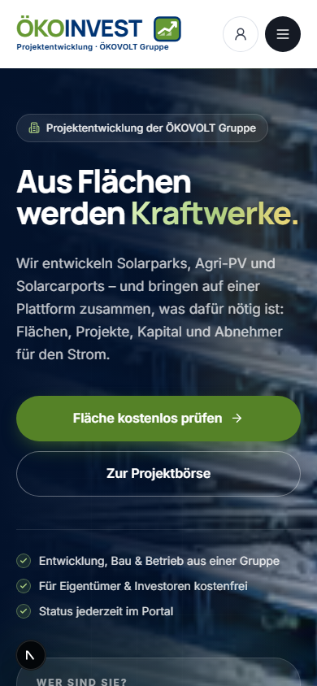

Jede Seite ist bei 390 px ohne horizontales Scrollen bedienbar; die Prüfung läuft automatisiert (axe + Screenshots in zwei Breiten).

---

## Das Ländermodell

**Eine Website, ein Design, vier Fassungen.** Das Land wird oben in der Leiste gewählt (DE · AT · CH) oder kommt direkt aus der URL – dann zeigt die gesamte Seite Recht, Zahlen, Rechner, Begriffe und Währung dieses Landes, sieht aber überall gleich aus. Die Wahl bleibt gespeichert. Sprache genauso: einmal EN gewählt, bleiben alle Seiten englisch.

```
oekoinvest.com/            → gemeinsame Fassung (alle Länder, DE-Werte gekennzeichnet)
oekoinvest.com/de/…        → Deutschland        oekoinvest.com/en/…      → Englisch
oekoinvest.com/at/…        → Österreich         oekoinvest.com/en/at/…   → Englisch + Österreich
oekoinvest.com/ch/…        → Schweiz            …
```

Grundsätze:

- **81 öffentliche Seiten** laufen über **dieselbe Seitenkomponente** in allen Fassungen – kein Kopieren, keine Abweichung im Design.
- **Keine Zwangsweiterleitung:** Ohne gespeicherte Wahl wird nie umgeleitet, auch nicht per Geo-IP; Suchmaschinen sehen immer die angefragte Fassung. `hreflang` (de-DE/de-AT/de-CH/en + x-default) und Canonicals je Fassung.
- **Strikte Ländertrennung:** Jede Zahl kommt aus dem Faktenregister mit Quelle und Stand. Gibt es für ein Land keinen geprüften Wert, erscheint ein ehrlicher Länderhinweis statt einer Zahl.
- **Schweiz-Details:** Auf `/ch` wird automatisch „ss“ statt „ß“ geschrieben; der Live-Strommarkt zeigt die eigene Schweizer Börsenauktion (stündlich, in Euro notiert).

---

## Funktionen der Website

**Rechner und Werkzeuge (Auswahl der 23 Tools):**

- 🧮 **Pachtrechner** – was bringt eine Fläche in 30 Jahren (Festpacht, indexiert, Umsatzbeteiligung)
- 🧾 **Rechnungs-Check Gewerbestrom** – amtliche Umlagen, Steuern, Börsenanteil; ehrliches Urteil bis hin zu „Ihr Vertrag ist marktgerecht“
- 🗺️ **Flächenpass** – Fläche auf amtlicher Karte einzeichnen → Hektar, Leistung, Ertrag, Restriktionen je Land
- 🏢 **Gebäudestrom-Rechner** – Mieterstrom/GGV (DE), GEA (AT), ZEV (CH)
- 🔌 **Netzanschluss-Begleiter** – Schritt für Schritt von der Anfrage bis zum Anschluss, je Land
- 🅿️ **Parkplatz-Check** – Solarpflicht je Bundesland, Potenzial in kWp
- 🏘️ **Kommunal-Rechner mit Ratsvorlage** – druckfertige Beschlussvorlage für den Gemeinderat
- ⚡ **Energiegemeinschafts-Rechner** + Software-Angebot mit Preisblatt, Wechsel-Check und White-Label

**Leads statt Kontaktformular:** Jeder Rechner erzeugt auf Wunsch einen **Bericht mit Rechenweg und Annahmenbuch**, der per Double-Opt-in-E-Mail zugestellt wird – mit Einwilligungsprotokoll und Länder-Routing bis ins Backoffice.

**Daten und Vertrauen:**

- 📊 **Strommarkt live** je Land (Fraunhofer ISE Energy-Charts, CC BY 4.0; Gebotszonen DE-LU, AT, CH)
- 📁 **Fakten & Quellen** – jedes veröffentlichte Faktum mit Primärquelle, Abrufdatum, Prüfstand und stabilem Zitier-Anker; Export CSV/JSON
- 📈 **Ausschreibungs-Monitor** und **CH-Strompreis-Atlas** aus amtlichen Quellen
- 🤖 **KI-Suche-ready:** `llms.txt`, Dataset-Schema, zitierfähige Definitionen – gebaut, um von KI-Suchmaschinen als Quelle zitiert zu werden
- 🧩 **Partner-Widgets** – einbettbare Mini-Rechner und Fristen-Ticker für Stadtwerke, ohne Cookies und ohne Tracking

---

## Die Plattform (Portal)

42 Portal-Bereiche für 11 Rollen, jede mit eigenem Cockpit:

| Rolle | Sieht und kann |
|---|---|
| Flächeneigentümer / Landwirt | Flächen, Pachtangebote, Verträge, Projektstatus |
| Investor | Projekte, Dealroom mit Datenraum, Q&A, Closing-Checklisten |
| Anbieter (Projektverkäufer) | Inserate, NDA-Abläufe, Käufer-Q&A |
| Unternehmen | Gewerbestrom-Ausschreibungen, Lastgänge, Verträge |
| EG-Mitglied | Abstimmungen, Abrechnungen, Energiedaten |
| Kommune | Projekte im Gemeindegebiet, Beteiligung, Unterlagen |
| Bank / Gutachter / Lieferant | Bankakte, Gutachten, Bestellungen – je nur das Nötige |
| Backoffice (10 Unterrollen) | CRM, Leads, KYC, Finanzierung, Buchhaltung, Marketing, Support |

Sicherheitsarchitektur: signierte Sitzungscookies (HttpOnly/Strict), Rechte-Matrix identisch in JavaScript und Python (automatisch geprüft über 40 Bereiche), Vier-Augen-Prinzip bei kritischen Aktionen, append-only-Hash-Kette für Einwilligungen und Audit, Personendaten getrennt und löschbar (Art. 17 DSGVO), Kontosperre bei sensiblen Aktionen, 2FA-Unterbau, Pen-Test-Suite (138 Sicherheitstests).

---

## Architektur

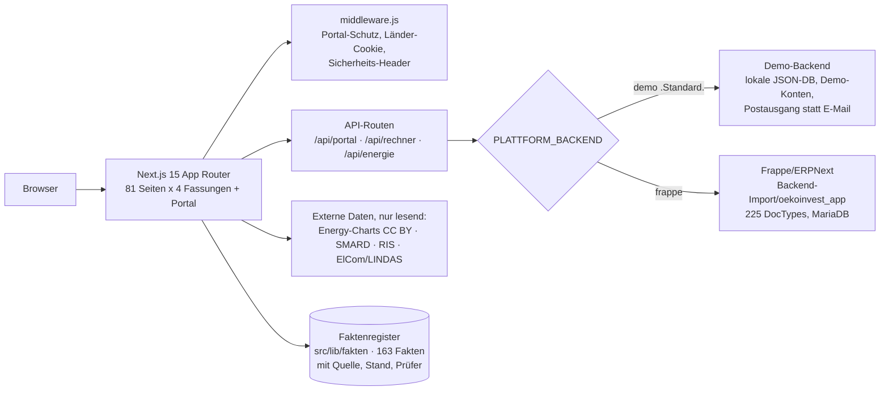

- **Eine Quelle für Zahlen:** Rechner und Texte ziehen Marktannahmen aus `src/lib/fakten` (Register mit Gültigkeits-Gate) bzw. `src/lib/invest/markt.js` (Fassade).
- **Demo ↔ Frappe austauschbar:** gleicher API-Vertrag (`docs/API.md`, maschinell gegengeprüft).
- **Keine Geschäftslogik im Browser:** Rechenlogik liegt in `src/lib/rechner/` (rein, getestet), Prüfungen serverseitig.

---

## Installation

**Voraussetzungen:** Node.js ≥ 20 (empfohlen 22+), npm ≥ 10, 8 GB RAM. Kein weiteres System nötig – das Demo-Backend startet ohne Datenbank.

```bash
# 1. Repository holen und Abhängigkeiten installieren
git clone <repo-url> oekoinvest-web
cd oekoinvest-web
npm install

# 2. Dev-Server starten (Turbopack, Port 3100)
npm run dev
# → http://localhost:3100
```

Das war's. Die Plattform läuft im **Demo-Modus**: lokale JSON-Datenbank unter `.data/`, vorangelegte Demo-Konten für jede Rolle (Passwort standardmäßig `Demo-2026!`, Liste in `docs/PLATTFORM.md`). E-Mails werden nicht versendet, sondern landen im Portal unter **Backoffice → Postausgang** – inklusive aller Bestätigungs-Links.

**Produktionsbuild testen, ohne den Dev-Server zu stören:**

```bash
NEXT_PUBLIC_SITE_URL=https://staging.example NEXT_DIST_DIR=.next-verify npx next build
```

**Frappe-Backend (optional, für den Produktivbetrieb):** Die Frappe-App liegt unter `Backend-Import/oekoinvest_app` (Frappe v15, MariaDB). Installation auf einer Bench, dann `PLATTFORM_BACKEND=frappe` samt `SERVER`, `API_KEY`, `API_SECRET` setzen – Details und API-Vertrag in `docs/PLATTFORM.md` und `docs/API.md`.

---

## Konfiguration

Alle Variablen sind in **`.env.example`** dokumentiert (eingecheckt, ohne Geheimnisse); echte Werte gehören in `.env.local`. Die wichtigsten:

| Variable | Zweck |
|---|---|
| `NEXT_PUBLIC_SITE_URL` | Basis-URL; Pflicht in jedem Produktionsbuild (sonst bricht der Build ab) |
| `NEXT_PUBLIC_SITE_ENV` | `production` schaltet die Indexierung frei – alles andere liefert automatisch `noindex` + `Disallow: /` |
| `PLATTFORM_BACKEND` | `demo` (Standard) oder `frappe` |
| `SESSION_SECRET` | Pflicht in Produktion – signiert die Portal-Sitzungen |
| `SERVER`, `API_KEY`, `API_SECRET` | Zugang zur Frappe-Instanz (nur bei `frappe`) |
| `NEXT_PUBLIC_GA_ID` | Google Analytics – lädt ausschließlich nach aktiver Einwilligung |

Schutz eingebaut: Ohne Produktionsumgebung ist die Seite **immer** auf `noindex` – eine Staging-Umgebung kann nie versehentlich bei Google landen.

---

## Tests und Qualitätssicherung

Ein Befehl prüft alles – das Gate muss vor jedem Merge grün sein:

```bash
npm run verify
```

| Schritt | Inhalt |
|---|---|
| 1 | **979 Unit-Tests** + **195 Charakterisierungstests** (jede Rechner-Ausgabe ist eingefroren; Änderungen an Zahlen brauchen einen begründeten Snapshot-Diff) |
| 2 | 13 Rechner-**Selbsttests** (Golden-Vektoren je Land) |
| 3 | **Claim-Lint** – verbotene Werbe- und Umweltaussagen („klimaneutral“, Superlative, Zusagen) werden maschinell gefunden |
| 4 | **axe**-Barrierefreiheitsprüfung der Kernseiten (Ratsche gegen Baseline, auch fürs Portal je Rolle) |
| 5 | **27 End-to-End-Tests** (Playwright): Lead-Strecken, Formulare, Berichte, Sprach- und Länderwechsel |
| 6 | **Faktenregister-Gate** – kein Wert ohne Quelle/Stand; abgelaufene Klasse-A-Fakten brechen den Lauf |
| 7 | **Ländermodell-Check** – 81 Seiten × Länderrouten, keine fest verdrahteten Länderpfade |

Dazu: ESLint, `python -m py_compile` + 369 Python-Stub-Tests fürs Frappe-Backend, Rechte-Paritätsprüfung JS ↔ Python, Pen-Test-Suite (118 + 20 Fälle), CLS-/Performance-Messungen per Playwright-Filmstreifen.

---

## Projektstruktur

```
├─ src/
│  ├─ app/
│  │  ├─ (stamm)/            # alle öffentlichen Seiten (gemeinsame Fassung) + /portal
│  │  ├─ (laender)/[land]/   # dieselben Seiten unter /de /at /ch
│  │  ├─ (en)/en/            # englische Fassungen (auch /en/<land>)
│  │  ├─ api/                # API-Routen (Portal, Rechner, Energie, Auth, Widgets)
│  │  └─ widgets/            # einbettbare Partner-Widgets (ohne Cookies)
│  ├─ components/            # Design-System (ui/), Seiten-Bausteine, Rechner, Portal
│  ├─ lib/
│  │  ├─ fakten/             # DAS Faktenregister: Werte + Quelle + Stand + Prüfer
│  │  ├─ rechner/            # Rechenlogik, rein und getestet
│  │  ├─ land/ · sprache/    # Ländermodell und Sprachregister
│  │  └─ plattform/          # Backend-Adapter (demo/frappe), Rechte, Sitzungen, Module
│  ├─ content/ratgeber/      # 38 Fachartikel
│  └─ data/                  # Stammdaten (site.js), Navigation, Länderdaten
├─ Backend-Import/
│  └─ oekoinvest_app/        # Frappe-App: 225 DocTypes, Kern-Module, API, Tests
├─ docs/                     # Fachkonzepte, API-Vertrag, Masterplan, Rechtsdossiers
├─ qa/                       # verify-Pipeline, E2E, axe, Claim-Lint, Pen-Test
├─ test/                     # Unit- und Charakterisierungstests
└─ uebergabe/                # Projektgedächtnis: Stand, Entscheidungen, Berichte
```

---

## Grundsätze

Dieses Projekt folgt harten Regeln, die maschinell durchgesetzt werden:

1. **Ehrlichkeit vor Conversion.** Keine erfundenen Zahlen, kein Fake-Social-Proof, keine Dark Patterns, keine Umweltfloskeln. Ein Rechner darf „Ihr Vertrag ist marktgerecht“ sagen.
2. **Jede Zahl hat eine Quelle.** Faktenregister mit Primärquelle, Abrufdatum und Gültigkeits-Gate; ungeprüfte Länderwerte werden nicht angezeigt.
3. **DE, AT und CH werden nie vermischt.** Eigene Rechtstexte, eigene Marktdaten, eigene Begriffe („Widmung“, „Parzelle“, Rappen).
4. **Datenschutz als Bauprinzip.** Statistik nur nach Einwilligung, Lastgänge bleiben im Browser, Einwilligungs-Hash-Kette ohne Personendaten, Löschkonzept bis in den Portal-Export.
5. **Nichts geht ungeprüft live.** Neue Seiten bleiben `noindex`, bis die fachliche Zweitprüfung erfolgt ist; Rechtstexte sind Entwürfe bis zur anwaltlichen Freigabe.

---

## Dokumentation

| Dokument | Inhalt |
|---|---|
| `docs/MASTERPLAN-DACH.md` | Strategie, Burggraben-Initiativen B0–B11, Umsetzungswellen |
| `docs/PLATTFORM.md` | Betrieb, Demo-Konten, Umgebungsvariablen, Frappe-Anbindung |
| `docs/API.md` + `docs/API-REGISTER.md` | API-Vertrag mit maschineller Konsistenzprüfung Demo ↔ Frappe |
| `docs/BETRIEB-BACKUP.md` | Sicherungskonzept, Restore-Anleitung, Notfallhandbuch |
| `docs/strang-r/` | Rechtstext-Entwürfe und Anwaltsdossiers inkl. Kanzlei-Briefing |
| `docs/DESIGN.md`, `docs/UX-AUDIT.md` | Design-System und UX-Befunde |
| `uebergabe/UEBERGABE.md` | Projektgedächtnis: Stand, Entscheidungen, offene Punkte |

---

## Vor dem Livegang

Die technische Checkliste (Details in `uebergabe/UEBERGABE.md`, Abschnitt „Offene Punkte“):

- [ ] Domain `oekoinvest.com` erwerben, Hosting (EU) und Mail-Versand mit AVV wählen
- [ ] `SESSION_SECRET`, `NEXT_PUBLIC_SITE_URL`, `NEXT_PUBLIC_SITE_ENV=production`, 2FA-Schlüssel setzen; `TZ=Europe/Vienna`
- [ ] Rechtstexte anwaltlich freigeben (Kanzlei-Briefing liegt fertig unter `docs/strang-r/pruefung-2026-10/`)
- [ ] Fachliche Zweitprüfung (E6) → `noindex` der neuen Seiten aufheben
- [ ] `next build` + Lighthouse auf dem Zielhosting, `npm audit` ohne hohe Funde
- [ ] Backup einrichten und Restore-Test nach `docs/BETRIEB-BACKUP.md`

---

## Lizenz

**Proprietär.** © ÖkoInvest GmbH, Gewerbegebiet 10, 5121 Ostermiething, Österreich. Alle Rechte vorbehalten – Nutzung, Vervielfältigung und Weitergabe nur mit ausdrücklicher Zustimmung.

Eingebundene offene Datenquellen werden lizenzkonform genannt (Energy-Charts/Fraunhofer ISE CC BY 4.0, SMARD CC BY 4.0, MaStR dl-de/by-2.0, opendata.swiss „Open use“); eigene Datenexporte stehen unter CC BY 4.0.

---

<div align="center">

**Aus Flächen werden Kraftwerke.** ☀️

*Gebaut mit Next.js 15, React 19, Tailwind v4 – und einer Armee von KI-Agenten unter menschlicher Aufsicht.*

</div>
