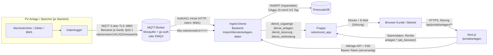

# Anlagen & Monitoring – Architektur (MQTT, TimescaleDB, Frappe, Portal)

Stand: September 2026. ÖkoInvest betreibt im Contracting PV-Anlagen (Freifläche, Dach, Carport, Agri-PV) und Speicher
für Unternehmen. Kunden und das Betriebsteam sehen nach dem Login einen Leitstand ihrer Bestandsanlagen.

**Grundsatz:** Frappe = Stammdaten und Prozesse · TimescaleDB (Ingest-Dienst) = Zeitreihen · Next.js = Anzeige und
Rechteprüfung. **MQTT-Werte sind Monitoring.** Abrechnungsrelevant sind ausschließlich geeichte Messstellen bzw. das
Smart-Meter-Gateway (Zählerstand-Monatswerte des Messstellenbetreibers in Frappe).

## 1. Überblick



ASCII-Fassung:

```
Datenlogger ──MQTT/TLS──▶ Broker ──Abo──▶ Ingest-Dienst ──▶ TimescaleDB
                            │  ▲              │  ▲
                   Auth/ACL │  └──────────────┘  │ Abfrage-API + SSE (Bearer)
                            ▼                    │
                       (Hook im Dienst)     Next.js (Portal) ◀── Browser
                                              │
                   Störungen, Zugänge ◀──────▶ Frappe (Stammdaten, Rechte, Benachrichtigungen)
```

## 2. MQTT-Vertrag (Version v1)

| Topic | Inhalt | QoS / retained |
|---|---|---|
| `oekoinvest/v1/<anlagenId>/<geraetId>/messwerte` | JSON-Messwert (unten) | 1 / nein |
| `oekoinvest/v1/<anlagenId>/<geraetId>/heartbeat` | `{"v":1,"ts":"…"}` mindestens alle 60 s | 0 / nein |
| `oekoinvest/v1/<anlagenId>/<geraetId>/status` | `online` beim Verbinden, **Last Will** `offline` | 1 / **ja** |

- `anlagenId` (`AL-…`) und `geraetId` (`GZ-…`) vergibt Frappe; MQTT-Benutzer `anl-<anlage>-<gerät>` (klein), Client-ID = Benutzer.
- **ACL:** Ein Gerät darf ausschließlich auf `oekoinvest/v1/<eigene Anlage>/<eigenes Gerät>/{messwerte,heartbeat,status}` veröffentlichen und nichts abonnieren. Der Dienst darf nur abonnieren. Es gibt keine Superuser.
- **Versionierung:** Präfix `v1` im Topic und `"v": 1` im Payload. Neue optionale Felder sind abwärtskompatibel; Breaking Changes bekommen `v2` (Dienst verarbeitet beide parallel während der Umstellung).
- **Zeit:** `ts` in UTC (ISO 8601). Nachlieferungen aus dem Puffer des Loggers bis 7 Tage, Zukunft > 5 min wird verworfen.

Payload `messwerte` (alle Messgrößen optional, mindestens eine; Einheit steckt im Namen):

```json
{
  "v": 1,
  "ts": "2026-09-30T10:15:00Z",
  "pv_leistung_kw": 412.5,
  "erzeugung_kwh": 1284512.4,
  "netzbezug_kwh": 20411.9,
  "einspeisung_kwh": 402118.6,
  "verbrauch_kw": 288.8,
  "speicher_soc_pct": 64.5,
  "speicher_leistung_kw": 12.4,
  "wechselrichter_status": "ok",
  "fehlercode": null
}
```

| Feld | Einheit | Bedeutung |
|---|---|---|
| `pv_leistung_kw` | kW | AC-Leistung aller Wechselrichter des Geräts |
| `erzeugung_kwh`, `netzbezug_kwh`, `einspeisung_kwh` | kWh | **Zählerstände** (monoton, nie zurücksetzen) |
| `verbrauch_kw` | kW | Verbrauch vor Ort |
| `speicher_soc_pct` | % | Ladestand 0–100 |
| `speicher_leistung_kw` | kW | **+ Laden / − Entladen** |
| `wechselrichter_status` | – | `ok` · `warnung` · `stoerung` · `aus` |
| `fehlercode` | – | Herstellercode als Text (≤ 80 Zeichen) |

Test: `mosquitto_pub` (siehe Assistent „Gerät verbinden“ bzw. `Backend-Import/dienste/anlagen-daten/README.md`).

## 3. Ingest-Dienst `Backend-Import/dienste/anlagen-daten`

Eigenständig deployt (eigene `package.json` mit `mqtt` und `pg`, Docker-Compose mit Broker + TimescaleDB + Dienst).

1. **Abonnieren** `oekoinvest/v1/+/+/+` (TLS, QoS 1, persistente Sitzung).
2. **Prüfen:** Topic-Schema, Zugang gehört zu Anlage/Gerät (zweite Linie hinter der Broker-ACL), Payload-Schema, Größe ≤ 8 KB.
3. **Plausibilisieren:** Zähler rückwärts bzw. Sprung > 1,5 × Nennleistung × Zeit → Register verworfen (`plausibel = false`, Flag) und Befund; Leistung > 130 % kWp markiert.
4. **Speichern** in der Hypertable `messwerte` (Kompression nach 7 Tagen), letzter Stand je Gerät in `geraet_stand`.
5. **Continuous Aggregates** 15 min / 1 h / 1 Tag (Tagesgrenze Europe/Vienna, Echtzeit-Aggregation an). Energie = Differenz der Zähler-Endstände je Intervall; Verbrauch = mittlere Leistung × Dauer.
6. **Retention:** Rohwerte 90 Tage · 15 min 2 Jahre · 1 h 5 Jahre · Tageswerte dauerhaft.
7. **Störungsregeln** → `anlagen.dienst_stoerung` (Frappe fasst offene Störungen je Regel zusammen, `schluessel` verhindert Wiederholung):

| Regel | Auslöser | Schwere |
|---|---|---|
| `offline` | Anlage in Betrieb, verbundenes Gerät, letzte Nachricht > `REGEL_OFFLINE_MINUTEN` (15) oder Last Will „offline“ | hoch |
| `fehlercode` | `fehlercode` gesetzt oder `wechselrichter_status = stoerung` | hoch |
| `minderleistung` | kW/kWp < 60 % des Medians vergleichbarer Anlagen der Region, nur wenn der Median ≥ 20 % (Sonne) und ≥ 3 Vergleichsanlagen | mittel |
| `zaehler_rueckwaerts`, `zaehler_sprung` | Plausibilisierung | mittel |

8. **Abfrage-API** (Bearer `DIENST_TOKEN`, zeitkonstanter Vergleich): `GET /v1/anlagen/:id/{aktuell,reihe,summen,zaehler,live}`, `GET /v1/uebersicht?anlagen=…`. `live` ist ein SSE-Strom (`event: messwert`, höchstens 1/s, Ping alle 15 s).
9. **Broker-Auth-Hook** (eigener Port, nur internes Netz): Mosquitto go-auth `POST /auth/user|/auth/acl|/auth/superuser` bzw. EMQX `POST /auth/emqx|/auth/emqx/acl`. Zugangsdaten holt der Dienst alle 60 s aus Frappe (`dienst_zugaenge`: nur scrypt-Hashes).

Passwort-Hash (Website-Demo, Frappe und Dienst identisch): `scrypt$16384$8$1$<salt b64>$<hash b64>` (64 Byte, NFKC). Das Klartext-Passwort wird **genau einmal** im Portal angezeigt.

## 4. Frappe (Stammdaten und Prozesse)

DocTypes (Kennungen per Controller, Rechte nur über die API):

| DocType | Präfix | Inhalt |
|---|---|---|
| Plattform Anlage | AL | Typ, Status, Standort grob, kWp, Speicher, Inbetriebnahme, Kunde (Konto), Organisation, Lastprofil |
| Plattform Anlagenkomponente | AK | Wechselrichter/Speicher/Zähler/Datenlogger/Module, Hersteller, Seriennummer, Garantie |
| Plattform Messpunkt | MP | Zählernummer, Art, Messstelle, **abrechnungsrelevant** (nur `geeicht`, Controller erzwingt es), SMGW, MSB |
| Plattform Geraetezugang | GZ | MQTT-Benutzer, Topic, **scrypt-Hash**, gesperrt, verbunden, letzte Verbindung/Nachricht |
| Plattform Stoerungsfall | ST | Regel, Schwere, Status offen/in Arbeit/behoben, Quittierung, Zuständiger, Kommentare (intern/öffentlich), Verlauf |
| Plattform Wartung | WA | Art, Datum, Status, Dienstleister, Bericht, nächste Fälligkeit, Kosten (intern) |
| Plattform Contracting Vertrag | CV | Laufzeit, Arbeitspreis ct/kWh, Grundgebühr, Indexierung, Kündigungsfrist (einer je Anlage) |
| Plattform Zaehlerstand Monatswert | ZM | Messpunkt, Monat, Register (OBIS 1.8.0/2.8.0), Stand, Menge (monoton geprüft) |

Rollen: Kunde = Konto `kunde_id` oder Mitglied der `organisation_id` (Rolle `unternehmen` im Menü); Backoffice mit
Bereich `anlagen` in der Rechte-Matrix (Unterrolle **`betrieb`**: Anlagen schreiben, Cockpit/Nutzer lesen; Leitung
schreiben; Buchhaltung und Nur-lesen lesen; Akquise/Transaktion kein Zugriff). Der Ingest-Dienst hat einen eigenen
API-Benutzer mit **nur** der Rolle `ÖkoInvest Anlagen-Dienst` (ausschließlich `dienst_*`).

Benachrichtigung `stoerung` (Glocke, E-Mail ohne Inhalte, abbestellbar): neue Störung → Betrieb (zuständige Person bzw.
alle mit Leserecht) und ab Schwere „mittel“ Kunde + Team; Behebung → Kunde + Team.

## 5. Next.js (Anzeige und Rechteprüfung)

- Stammdaten: `src/lib/plattform/backend/anlagen.js` (Demo `backend/demo/anlagen.js`, Frappe `backend/frappe/anlagen.js`).
- Messdaten: `src/lib/plattform/messdaten/{index,dienst,simulator,auswertung}.js`. **Immer zuerst** über das Backend prüfen, ob der Nutzer die Anlage sehen darf (403/404), dann Messdaten nur für diese Anlagen holen.
- `simulator.js` (Demo): deterministische Kurven – PV nach Sonnenstand, Region, Monatsverteilung und Tageswetter; Lastprofile Gewerbe/Industrie/Landwirtschaft; Speicherlogik (Eigenverbrauch bzw. Lastspitzen); monotone Zählerstände; gelegentliche Wechselrichterabschaltungen und Szenarien (offline, Teilausfall, Minderleistung). Die Regeln des Dienstes werden im Demo-Betrieb beim Abruf nachgebildet.
- Live: `GET /api/portal/anlagen/[id]/live` (SSE; Demo simuliert, Betrieb Proxy auf den Dienst, Token bleibt auf dem Server, max. 6 Ströme je Konto). Die Oberfläche zeigt „Stand vor x s“ und markiert Daten > 90 s als veraltet.
- Seiten: `/portal/anlagen` (Kacheln/Liste/Karte, Summen, Ampel), `/portal/anlagen/[id]` (Live, Energiefluss, Diagramme Tag/Woche/Monat/Jahr mit Soll-Ist, Zählerstände + CSV, Störungen, Technik & Wartung, Vertrag & Kosten), `/portal/admin/anlagen` (Störungs-Leitstand), `/portal/admin/anlagen/neu` (Assistent), `/portal/admin/anlagen/[id]` (Pflege, „Gerät verbinden“).
- Vertrag: [`docs/API.md`](./API.md), Abschnitt 10. Test: `node scripts/plattform-test-anlagen.mjs`.

## 6. Inbetriebnahme

1. Frappe migrieren (`bench --site <site> migrate`): legt DocTypes und die Rolle `ÖkoInvest Anlagen-Dienst` an.
2. Frappe-Benutzer für den Dienst (Website User, nur Rolle `ÖkoInvest Anlagen-Dienst`), API-Key/Secret erzeugen.
3. `site_config.json`: `oekoinvest_mqtt_host`, `oekoinvest_mqtt_port` (Anzeige im Assistenten).
4. Dienst: Zertifikate, `.env` aus `.env.example`, `docker compose up -d --build` (siehe `Backend-Import/dienste/anlagen-daten/README.md`).
5. Website: `ANLAGEN_DATEN_URL`, `ANLAGEN_DATEN_TOKEN` (= `DIENST_TOKEN`), `ANLAGEN_MQTT_HOST`, `ANLAGEN_MQTT_PORT`.
6. Backoffice-Konten des Betriebs: Unterrolle `betrieb` unter `/portal/admin/rechte`.
7. Je Anlage: anlegen (Assistent), Kunde/Organisation zuordnen, Messpunkte (geeicht) und Vertrag erfassen, „Gerät verbinden“, Passwort im Datenlogger hinterlegen, auf „verbunden“ warten.

## 7. Grenzen und offene Punkte

- Minderleistung braucht ≥ 3 Vergleichsanlagen je Region; Einstrahlungsdaten (z. B. Satellitendaten) können später die Erwartung verfeinern.
- Die Kosten-/Ersparnisanzeige ist eine Schätzung aus Monitoring-Werten; maßgeblich ist die Abrechnung über die geeichten Zähler.
- Datenlogger ohne MQTT/TLS brauchen ein Gateway; Client-Zertifikate je Gerät sind im Broker vorbereitet (`require_certificate`).
