# Prozesslandkarte ÖkoInvest-Plattform

Stand: 30.09.2026 · Alle End-to-End-Prozesse mit Rollen, Statusfolgen, Übergaben und Systemen. Maßgebliche Statusautomaten: `src/lib/plattform/prozesse.js` und `docs/API.md` (die Diagramme fassen zusammen, sie ersetzen den Vertrag nicht). Handbücher je Rolle: [README](./README.md).

## Legende

| Kürzel | Bedeutung |
|---|---|
| **Web** | Next.js-Website und Portal (`/portal/**`), Rechteprüfung, PDFs |
| **Frappe** | Kern-Backend `oekoinvest_app` (DocTypes, Scheduler, Desk, E-Mail) |
| **ERPNext** | optional: Rechnungen/Gutschriften, Zahlungen, Anlagen, Projekte |
| **Geo** | Geodaten-Dienst (PostGIS) – ohne Personenbezug |
| **IoT** | Messdaten-Dienst (MQTT → TimescaleDB) |
| **Extern** | Identitätsanbieter, Auskunftei, Register/Verrechnungsstelle, Notar, Grundbuch, Bank, Energieversorger, Netzbetreiber |
| BO-… | Backoffice-Unterrolle (Leitung, Akquise, Transaktion, Buchhaltung, Betrieb, Compliance, Energie, Projektleitung) |

## 0. Geschäftsmodelle im Überblick

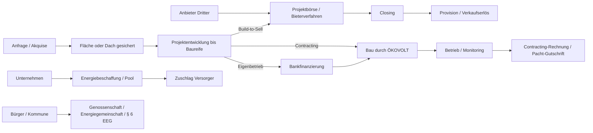

## 1. Anfrage → Vorgang

Rollen: Interessent (öffentlich) → BO-Akquise (bzw. Transaktion/Energie je Typ). Systeme: Web (`POST /api/anfrage`), Frappe (Vorgang, CRM-Kontakt), E-Mail.

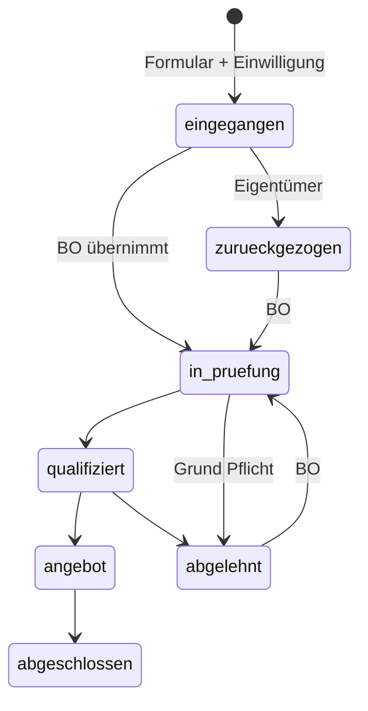

Übergaben: Typ `flaeche/agri/kommune` → Akquise · `investor/projekt` → Transaktion · `reststrom` → Energie · `carport/speicher` → Vertrieb/Projektleitung · Registrierung mit gleicher E-Mail verknüpft den Vorgang mit dem Konto (nach bestätigter Adresse).

## 2. Flächenpacht (Freifläche, Agri-PV, Dach)

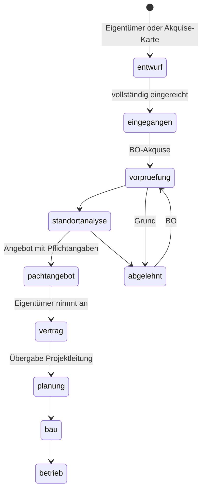

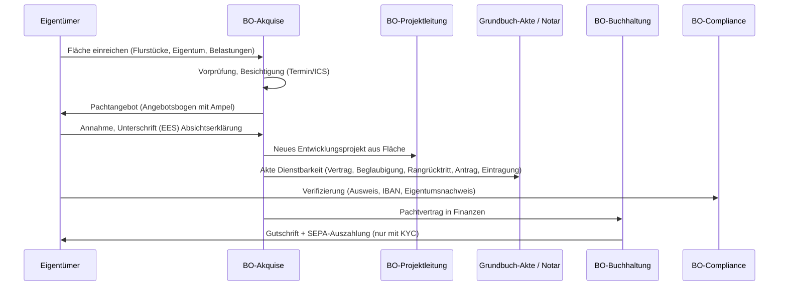

## 3. Aktive Flächenakquise (Geodaten → Brief)

Rollen: BO-Akquise, BO-Leitung, BO-Compliance (Sperrliste). Systeme: Geo, Web (Akquise-Karte), Frappe (Akquise-Ziel, CRM), Extern (Verrechnungsstelle Grundbuch), Post.

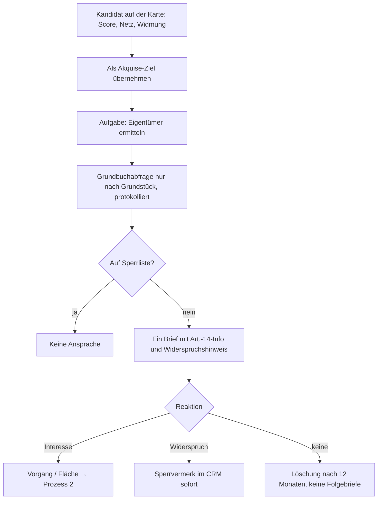

## 4. Projektentwicklung → Übergabe

Rollen: BO-Projektleitung, Gutachter (Einladung), Eigentümer (vereinfachte Sicht), Co-Investor (freigegeben), BO-Leitung (Geschäftsmodell). Systeme: Web, Frappe, ERPNext optional (Project/Task/Timesheet).

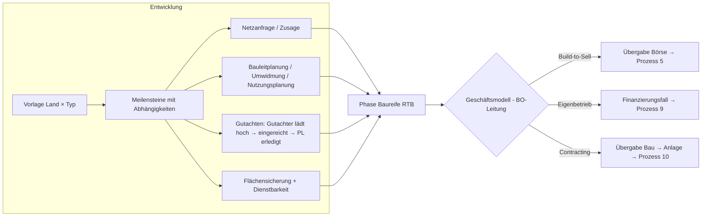

Regeln: Erledigen nur mit erledigten Vorgängern (409) und Pflichtdokument bzw. begründetem Verzicht (422); Gutachter setzt nie „erledigt“.

## 5. Projektbörse und Deal-Room

Rollen: Anbieter, Investor, BO-Transaktion, BO-Compliance (KYC), BO-Leitung. Systeme: Web, Frappe, E-Mail, KI (optional).

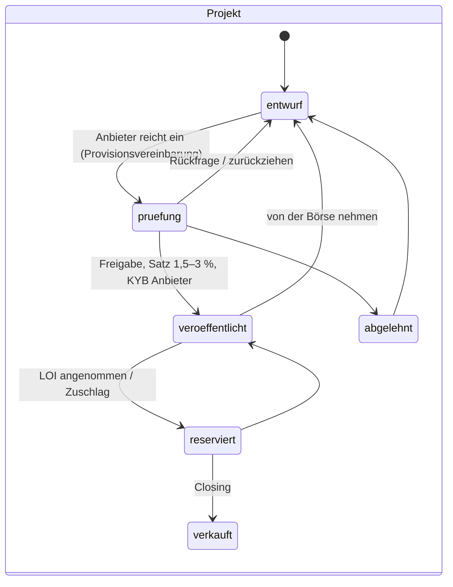

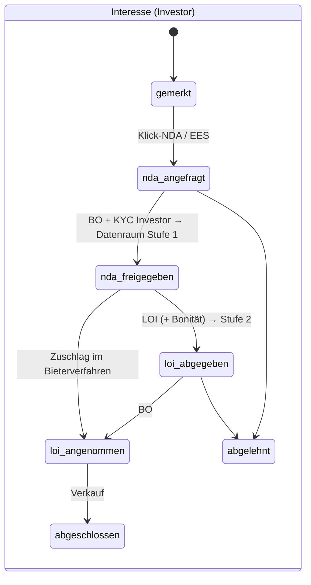

Fragen & Antworten: `eingereicht → freigegeben (Anbieter, Frist) → beantwortet → veroeffentlicht` · `abgelehnt` · Rückgabe `beantwortet → freigegeben`.
Bieterverfahren: `laufend → auswertung → zuschlag → abgeschlossen` · `abgebrochen`; Runden indikativ/verbindlich; Gebote verdeckt, Zuschlag erst nach Rundenende, KYC des Bieters.

## 6. Closing → Provision → Rechnung

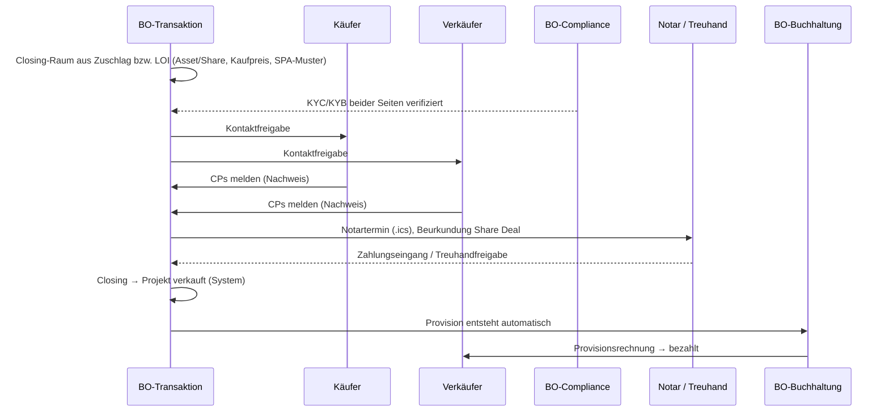

## 7. Grundbuch und Dienstbarkeit

Rollen: BO-Akquise/Projektleitung/Transaktion, Eigentümer bzw. Dachgeber, Notar, Grundbuchgericht/-amt, Grundpfandgläubiger (Bank). Systeme: Web (Akte, Muster-PDF, Signatur), Frappe (Fristen täglich).

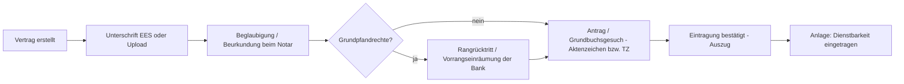

DE § 29 GBO · AT § 31/§ 32 GBG · CH Art. 732 ZGB. Die EES ersetzt die Beglaubigung nie.

## 8. Identität, Bonität, Register (Querschnitt)

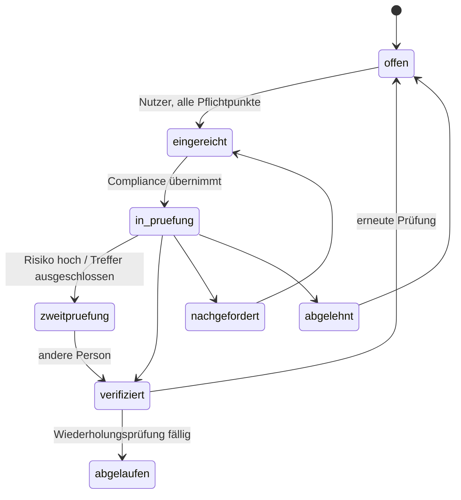

Gating (Freigabe-Sperren, 409 `kyc`): NDA/Datenraum, LOI, Gebot, Zuschlag, Veröffentlichung, Auszahlung (+ IBAN + Eigentumsnachweis), Contracting-Vertrag, Signing/Closing (beide Seiten).
Externe Dienste liefern nur Hinweise an den Fall (Identitätsanbieter per signiertem Webhook, MRZ-Vorprüfung, Registerabruf mit Datum). **Bonität:** Anlass → Information des Betroffenen → Auskunft → Mensch entscheidet mit Begründung.

## 9. Bankfinanzierung Eigenbetrieb

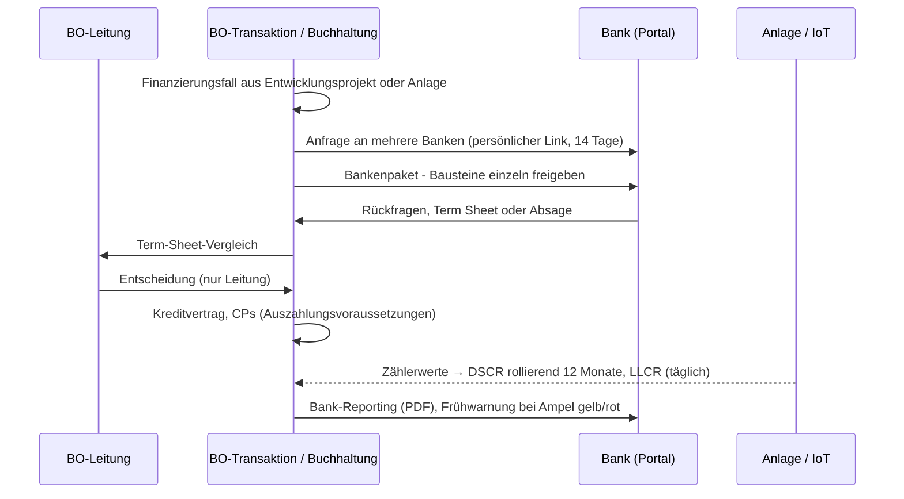

## 10. Contracting: Anlage, Monitoring, Störung, Abrechnung

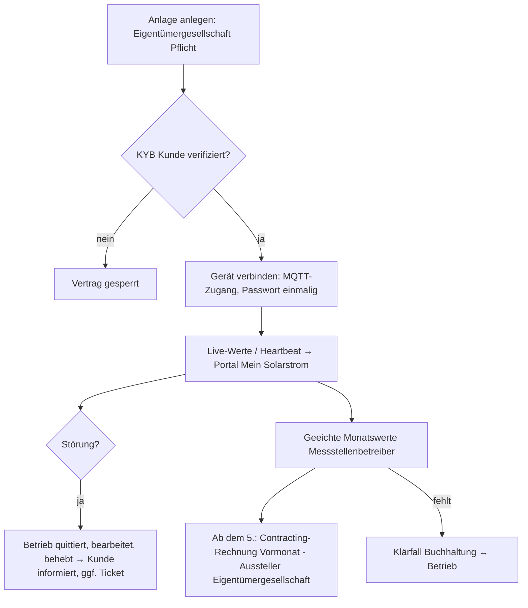

## 11. Pacht-Abrechnung und Auszahlung

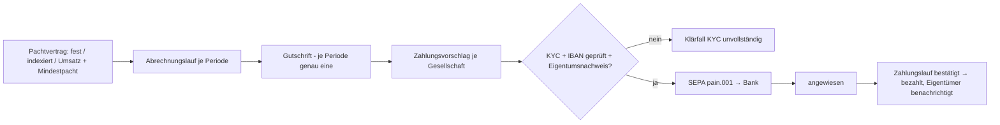

## 12. Energiebeschaffung und Versorger-Ausschreibung

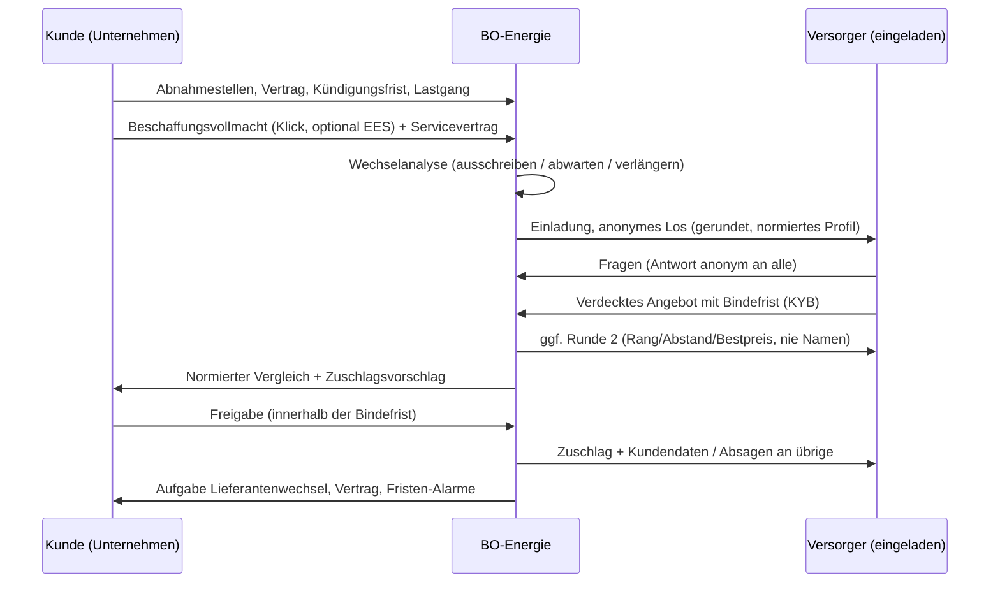

Status Ausschreibung (vereinfacht): `entwurf → angebotsphase (Runde n) → auswertung → vorschlag → freigabe Kunde → zuschlag` · `abgebrochen`. Kommunen: nur Markterkundung (Vergaberecht).

## 13. Elektronische Unterschrift

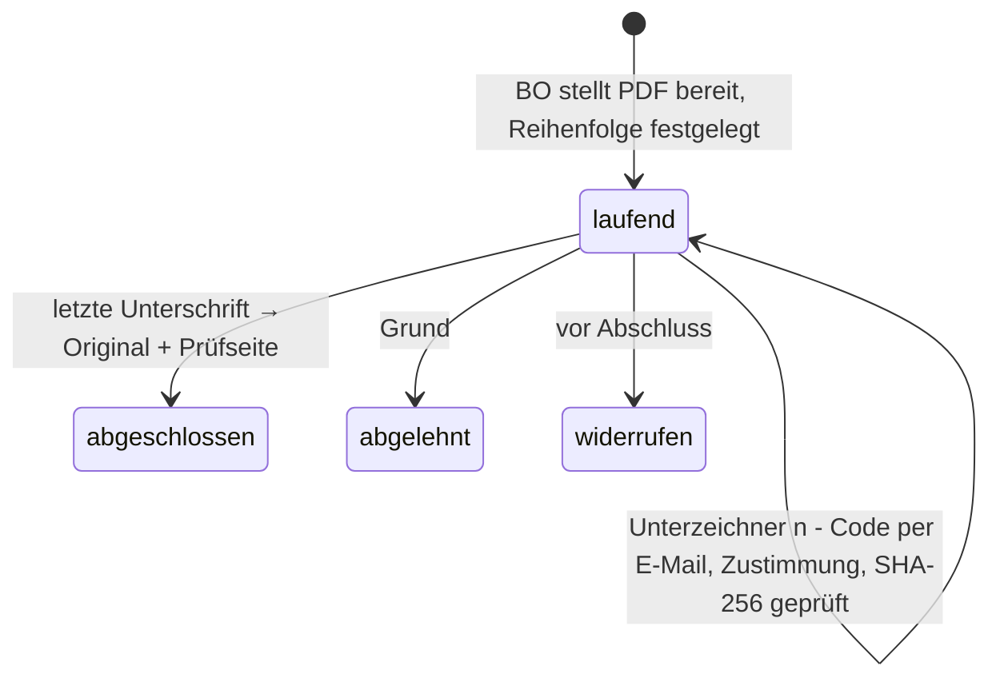

Protokoll: Zeit, IP, Browser, Code-Bestätigung, Hash vorher/nachher. Einfache elektronische Signatur – keine Schriftform, keine Beglaubigung.

## 14. Termine und Support

- **Termin:** öffentlich oder Portal → Zuständigkeit (Wunsch → Gebiet → geringste Belegung) → Sperre gegen Doppelbuchung → ICS an Kunde und Mitarbeiter → Erinnerung 24 h → Umbuchen/Absagen per Einmal-Link; Abwesenheit → automatische Vertretung.
- **Support:** Ticket (Kunde oder aus Störung) → Priorität/SLA → Zuweisung → öffentliche Antwort (erfüllt Reaktionsziel) / interne Notiz → gelöst → Kundenantwort öffnet wieder → geschlossen.

## 15. Kommune, Genossenschaft, Energiegemeinschaft

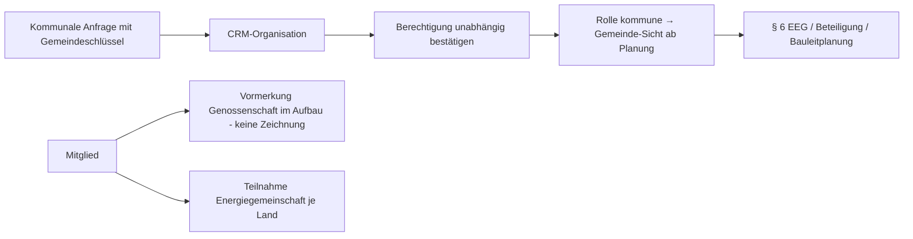

## 16. Systemübergaben (Wer schreibt wo?)

| Prozess | Web | Frappe | ERPNext | Geo | IoT | Extern |
|---|---|---|---|---|---|---|
| Anfrage/CRM | Formular, Portal | Vorgang, CRM, Automationen | – | – | – | E-Mail |
| Akquise | Karte | Akquise-Ziel, Aufgabe, Sperrvermerk | – | Kandidaten, Scoring | – | Verrechnungsstelle Grundbuch, Post |
| Entwicklung | Gantt, Portale | Projekte, Meilensteine | Project/Task/Timesheet (opt.) | Netzabstand | – | Gutachter, Behörden, Netzbetreiber |
| Börse/Deal-Room | Exposé, Datenraum, Q&A, Gebote | Interessen, Zugriffe, Hash-Kette | – | – | – | KI (opt.) |
| KYC/Bonität | Verifizierung | KYC-Fall (verschlüsselt) | – | – | – | Identitätsanbieter, Auskunftei, Register |
| Closing/Grundbuch | Räume, Muster-PDF, EES | Akten, Fristen | – | – | – | Notar, Grundbuch, Treuhand |
| Finanzen | Belege, SEPA-Datei | Abrechnung, Klärfälle | Invoices, Payment, Asset (opt.) | – | Zählerwerte | Hausbank |
| Energie | Handelsdesk, Portale | Ausschreibung, Vollmacht, Verträge | – | – | – | Energy-Charts, EEX-Lizenz, Versorger |
| Finanzierung | Cockpit, Bank-Portal | Fall, Covenants (täglich) | – | – | DSCR-Basis | Banken |
| Contracting | Mein Solarstrom, Leitstand | Anlagen, Störungen | Sales Invoice, Asset (opt.) | – | Messwerte, Live | Messstellenbetreiber |
